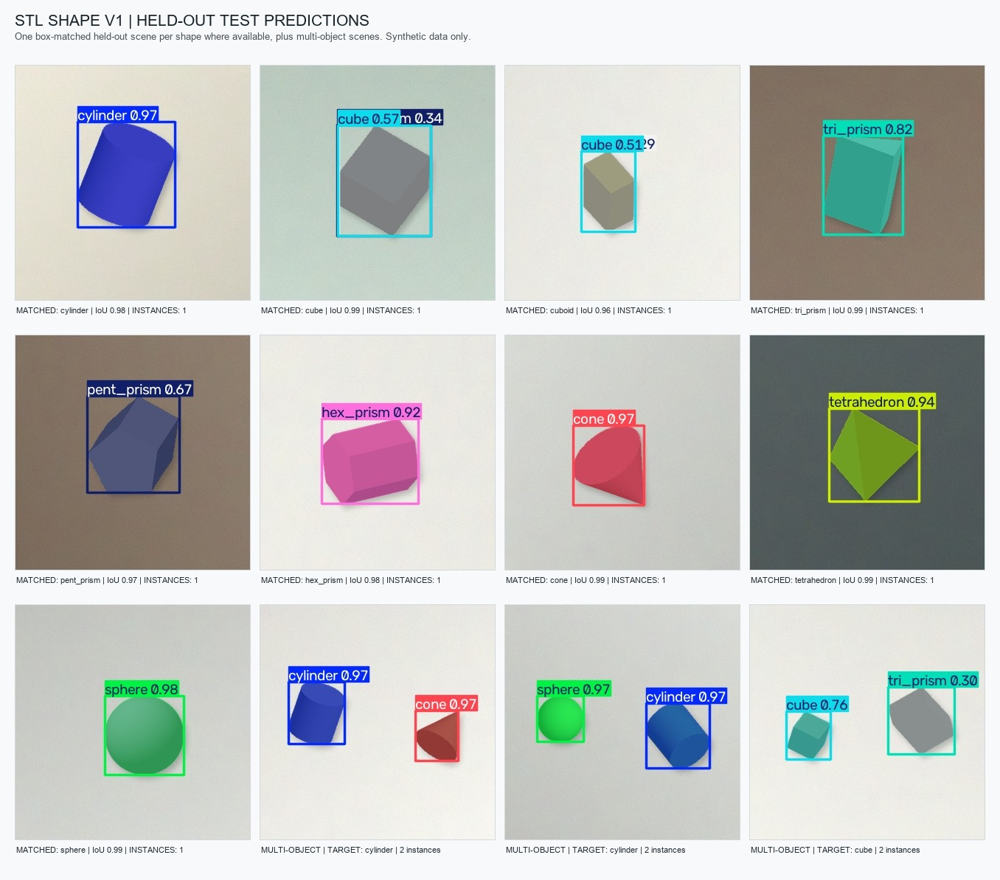

# 九类 STL 合成实例分割首版结果

**结论：** 已用九种训练 STL 完成一版 YOLO11n-seg 形状实例分割模型。它在独立合成测试集上的 mask mAP50 为 **0.915**、mask mAP50-95 为 **0.872**。当前最明显的短板是正方体 `cube` 与长方体 `cuboid` 混淆。

## 本轮做了什么

九种 40 mm STL 自动渲染成 1080 张 320×320 图像，每张包含 1～4 个彼此分开的物块；实例轮廓由渲染几何自动生成，没有手动画掩膜。数据按场景分成 864 张训练图、108 张验证图和 108 张测试图，同一场景不会跨集合。

模型使用 CPU 训练 20 轮，输入尺寸 320，batch 为 4，随机种子为 42。最佳权重已归档在 `models/trained/stl_shape_v1/best.pt`。

## 独立测试结果

| 指标 | 结果 | 说明 |
|---|---:|---|
| 测试图像 | 108 张 | 未用于训练；由 273 个物块实例组成 |
| Mask precision / recall | 0.827 / 0.902 | 预测掩膜的整体精确率和召回率 |
| Mask mAP50 | 0.915 | 掩膜与标注的 IoU 阈值为 0.50 时的平均 AP |
| Mask mAP50-95 | 0.872 | IoU 阈值从 0.50 到 0.95 的平均 AP；要求更严格 |

| 形状 | 测试实例 | Mask mAP50 | Mask mAP50-95 |
|---|---:|---:|---:|
| cylinder（圆柱体） | 32 | 0.992 | 0.965 |
| cube（正方体） | 33 | 0.808 | 0.768 |
| cuboid（长方体） | 32 | 0.761 | 0.736 |
| tri_prism（三棱柱） | 28 | 0.931 | 0.884 |
| pent_prism（五棱柱） | 34 | 0.881 | 0.831 |
| hex_prism（六棱柱） | 27 | 0.919 | 0.873 |
| cone（圆锥） | 27 | 0.963 | 0.912 |
| tetrahedron（四面体） | 27 | 0.989 | 0.928 |
| sphere（球体） | 33 | 0.995 | 0.947 |

`cuboid` 的测试召回率为 **0.518**，是最需要改进的类别。现有混淆矩阵也显示，`cube` 与 `cuboid` 经常互相误判。总分较高不能掩盖这一类别短板。

## 预测拼图

每类固定取实例数最少、场景编号最小的一张测试图，再加入两件、三件、四件场景各一张，不按预测是否正确挑图。图上编号对应下方中文类别和置信度，重复框和误识别完整保留。拼图与 [中文演示页面](stl_shape_v1_demo/index.html) 使用同一份模型输出；12 张展示样例不替代上面的完整测试集指标。

页面可离线打开并切换原图、参考轮廓与预测轮廓。双击项目根目录 `演示模型.cmd` 后，还可以导入自己的图片，由本机模型实际识别形状；现场操作见 [老师演示操作说明](老师演示操作说明.md)。

## 结果边界与下一步

这些数值只说明模型能较好拟合当前的 STL 渲染数据。训练画面没有真实托盘、最终固定相机、实际光照、材料颜色和真实物块，因此不能用来声称实物识别准确率、颜色识别能力、抓取坐标精度或 MaixCAM 2 部署成功。渲染图里的物块也没有互相遮挡或接触，真实遮挡边界仍需要人工抽查。

**给老师说明时可以这样说：**“我们先用九个建模文件自动生成分割训练图和标签，训练出第一版九类形状模型。模型在单独保留的合成测试集上达到 mask mAP50 0.915、mAP50-95 0.872，但正方体和长方体容易混淆。因为目前还没有托盘和固定相机，这些是合成数据指标，不代表实物效果。拿到实物后会按最终相机重新拍摄、抽查标签，再用独立真实测试集验证。”

当前不需要人工补画这批合成掩膜。拿到托盘、实物和最终相机后，下一步才是按固定视角采集真实图像，并对遮挡、接触和类别有歧义的标签进行人工复核。

## 复现与产物

- 权重：`models/trained/stl_shape_v1/best.pt`
- 权重 SHA-256：`5c7dd29d84c0b71b3110ca0da0f101210648e85b7e9badded00c2ab09f3b057e`
- 可复算指标：`docs/视觉训练指标_STL首版.json`
- 本机训练配置与曲线（生成产物，不入库）：`runs/segment/runs/segment/stl_shape_v1/`
- 完整测试集预测：`runs/segment/stl_shape_v1_test_verified_predictions/`
- 重新评估：`python vision/scripts/evaluate_stl_test.py --model models/trained/stl_shape_v1/best.pt`
- 重新生成拼图：`python vision/scripts/make_stl_prediction_montage.py`
- 导入自选图片识别：双击项目根目录 `演示模型.cmd`，在本机页面选图并点击“识别形状”
- 重新计算 12 张预置演示图：`.venv-vision/Scripts/python.exe vision/scripts/predict_stl_demo.py --no-open`
- 演示样例与输出：`docs/stl_shape_v1_demo/`；`index.html` 可单文件复制，`predictions.json` 保存实际掩膜和类别
