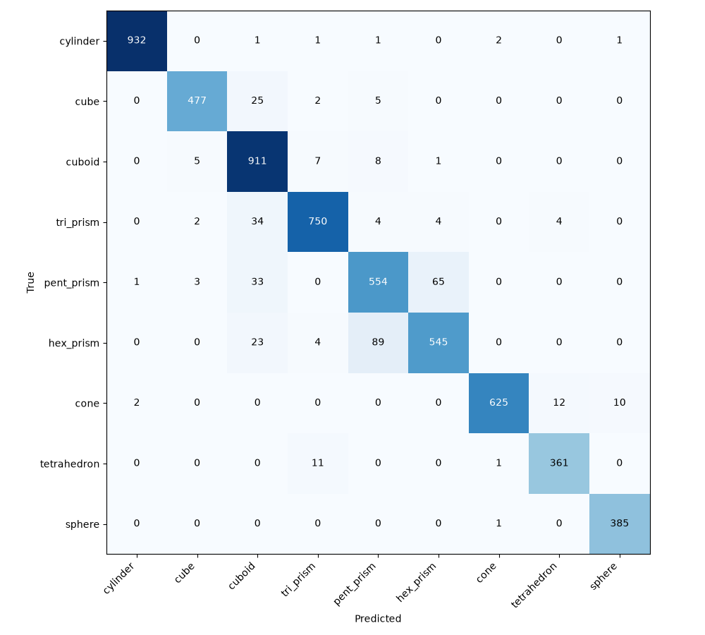

# 三组易混形状专项实验结果

本轮是 CPU 试运行，不是 640 输入、150 轮的正式训练。实物效果未验证。

原模型严格实例得分 **57.10%**；验证集选定流程在冻结测试集为 **93.62%**。
测试包含 2880 张图片、5907 个物块；99%目标尚未达到。

**回归限制：首版旧测试集严格得分由 72.16% 降至 65.69%。专项版尚不能视为全面替代原模型，原演示入口继续保留。**

评分要求每个真实物块只检出一次且类别正确；漏检、错分、重复检出都会失败，背景额外误检也计入分母。两版在同一套冻结图片上比较。

原模型按原演示设置评估；专项流程包含本轮训练、验证选定的去重和类别复核。因此提升是整条流程的收益，不能全部归功于训练。

| 指标 | 原模型 | 专项流程 |
|---|---:|---:|
| 严格实例得分 | 57.10% | 93.62% |
| 整张图片全部识别正确 | 37.67% | 88.68% |
| 漏检物块数 | 371 | 5 |
| 重复检测数 | 1703 | 9 |
| 额外误检数 | 69 | 2 |

复核器启用；所有选择只使用验证集。

## 各类识别

类别的唯一正确比例已扣重复检出；Precision、Recall、F1 使用一对一匹配的常规定义。

| 形状 | 实例数 | 原模型唯一正确 | 专项唯一正确 | 专项 Precision | 专项 Recall | 专项 F1 |
|---|---:|---:|---:|---:|---:|---:|
| 圆柱体 | 938 | 90.19% | 99.25% | 99.57% | 99.36% | 99.47% |
| 正方体 | 510 | 11.76% | 93.53% | 97.95% | 93.53% | 95.69% |
| 长方体 | 934 | 30.30% | 97.22% | 88.45% | 97.54% | 92.77% |
| 三棱柱 | 798 | 61.03% | 93.98% | 96.77% | 93.98% | 95.36% |
| 五棱柱 | 657 | 32.42% | 84.32% | 83.81% | 84.32% | 84.07% |
| 六棱柱 | 661 | 68.53% | 82.45% | 88.62% | 82.45% | 85.42% |
| 圆锥 | 650 | 71.85% | 96.00% | 99.05% | 96.15% | 97.58% |
| 四面体 | 373 | 77.48% | 95.98% | 94.50% | 96.78% | 95.63% |
| 球体 | 386 | 81.35% | 99.74% | 97.22% | 99.74% | 98.47% |

## 三组双向错分

比例以对应真实类别的全部实例为分母，漏检和其他类别错误另计。

| 真值→预测 | 原模型错分数/实例数 | 原模型错分比例 | 专项错分数/实例数 | 专项错分比例 |
|---|---:|---:|---:|---:|
| 圆柱体→圆锥 | 12/938 | 1.28% | 2/938 | 0.21% |
| 圆锥→圆柱体 | 14/650 | 2.15% | 2/650 | 0.31% |
| 三棱柱→长方体 | 80/798 | 10.03% | 34/798 | 4.26% |
| 长方体→三棱柱 | 101/934 | 10.81% | 7/934 | 0.75% |
| 正方体→长方体 | 152/510 | 29.80% | 25/510 | 4.90% |
| 长方体→正方体 | 257/934 | 27.52% | 5/934 | 0.54% |

## 困难子集

| 场景 | 图片 | 原模型严格得分 | 专项严格得分 |
|---|---:|---:|---:|
| 单个物块 | 288 | 69.10% | 95.49% |
| 两个物块分开摆放 | 288 | 65.62% | 97.05% |
| 三个或四个物块 | 288 | 72.40% | 94.56% |
| 较低拍摄角度 | 288 | 61.63% | 91.32% |
| 接近俯视 | 288 | 52.78% | 90.10% |
| 物块在图中较小 | 288 | 41.32% | 83.68% |
| 靠近画面边缘 | 288 | 65.97% | 98.78% |
| 物块与背景颜色接近 | 288 | 66.84% | 96.35% |
| 物块相接触 | 288 | 53.45% | 97.74% |
| 部分遮挡 | 288 | 18.92% | 91.35% |

## 仍需解决的问题

错分最多的五个方向如下；这些计数不包含漏检和额外误检。

- 六棱柱→五棱柱：89 个。
- 五棱柱→六棱柱：65 个。
- 三棱柱→长方体：34 个。
- 五棱柱→长方体：33 个。
- 正方体→长方体：25 个。

分数最低的三个场景：物块在图中较小 83.68%；接近俯视 90.10%；较低拍摄角度 91.32%。
这些结果用于记录局限；下一轮仍用验证集选择改进，并另留新测试批次，不能反复针对本测试集调分。

## 首版测试集回归

另外检查首版 108 张、273 个实例的旧测试集。该检查不用于选择参数，也不与新冻结集混算。
相同严格口径：原模型 72.16% → 专项流程 65.69%。

| 形状 | 原模型唯一正确 | 专项唯一正确 |
|---|---:|---:|
| 圆柱体 | 93.75% | 90.62% |
| 正方体 | 45.45% | 24.24% |
| 长方体 | 9.38% | 59.38% |
| 三棱柱 | 85.71% | 57.14% |
| 五棱柱 | 61.76% | 73.53% |
| 六棱柱 | 74.07% | 74.07% |
| 圆锥 | 88.89% | 85.19% |
| 四面体 | 100.00% | 25.93% |
| 球体 | 100.00% | 100.00% |

## 实验记录

- 完成时间：2026-11-01T04:03:17.277608-08:00；配置 `cpu_pilot`。
- 主模型训练：540 张图、输入 320、实际 20 轮（上限 20）。
- 验证选定候选：`val_trained_best_1`；最终验证严格得分 92.95%。
- 推理置信度阈值 0.25；类别无关去重 开启。
- 模型 SHA-256：`d51cc9c95e9949691f9aafc8bf7efd5adf746b2578f3e7a0b755553a127f36e0`。
- 流程配置 SHA-256：`eb849210fcbeea2437f6ebc917aeb148af334fe7794fba1ac5ee0c0b1159b410`。
- 冻结清单 SHA-256：`71e604416562a0f06ebf8e7539d79db17ceef0dfaa6a77ae82c9bd16d3a9e683`。
- 运行环境版本：python 3.14.0；torch 2.15.0+cpu；ultralytics 8.4.194；numpy 2.5.4；Pillow 13.0.0；scipy 1.18.1。
- 完整数值、验证选择与两版逐类统计见 [指标 JSON](视觉训练指标_三组专项.json)。

主分割模型标准 mask mAP50=0.9761，mAP50-95=0.9188；它们不是逐物块准确率。

## 使用与下一步

双击根目录 `演示专项模型.cmd`，等待页面显示“本机模型已就绪”；点“选择图片”，再点“识别形状”。识别时保持启动窗口打开。
先保持最低置信度为 0.25，与本次验收一致；修改阈值后的表现没有单独验收。旧入口继续展示首版。页面明确区分两版指标。
完整方法与复现步骤见 [专项训练说明](三组易混形状专项训练.md)。本轮无需手工标注。

错误图绿线为真值、红线为预测，图中文字使用类别英文缩写。按固定测试顺序保存错误图，不挑选好看的结果。

后续需完成完整规模、640 输入的正式训练；使用验证集分析错误和选择参数。如果根据本次测试结果继续改方案，最终99%验收应另留新批次。未达到目标时不能把任务表标为达标。
